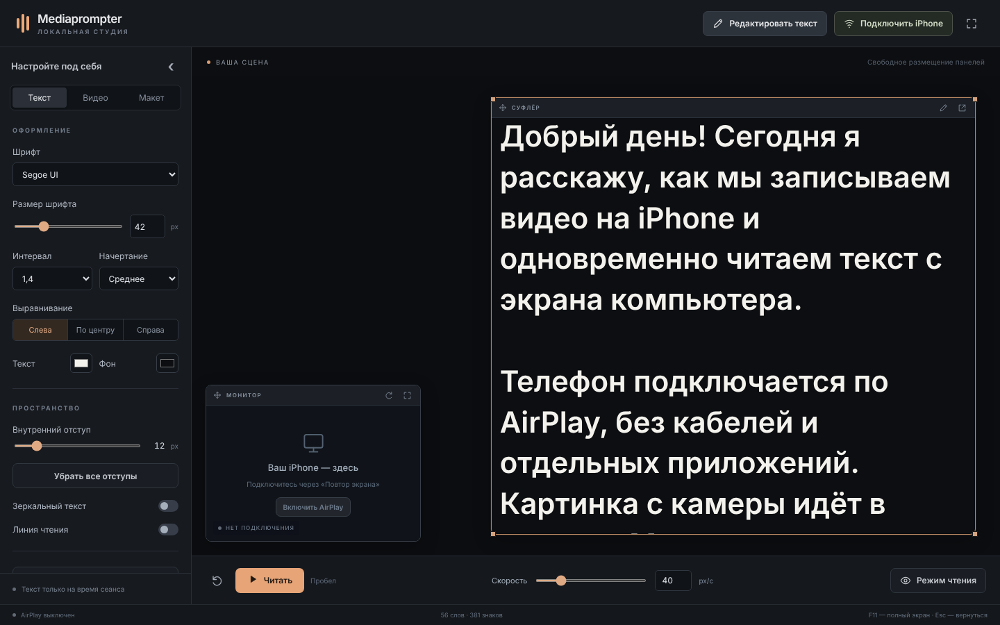
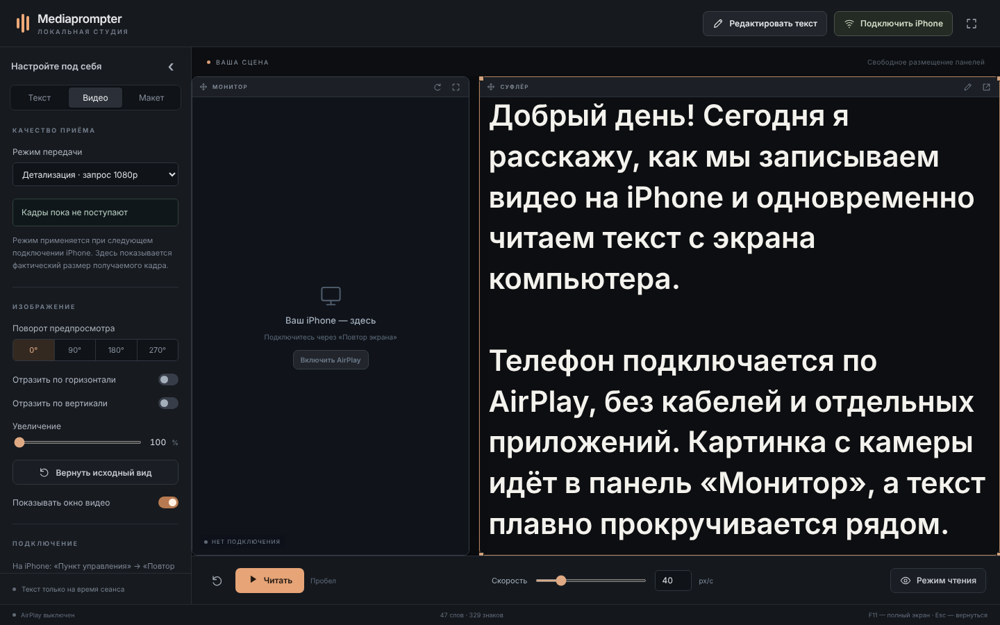
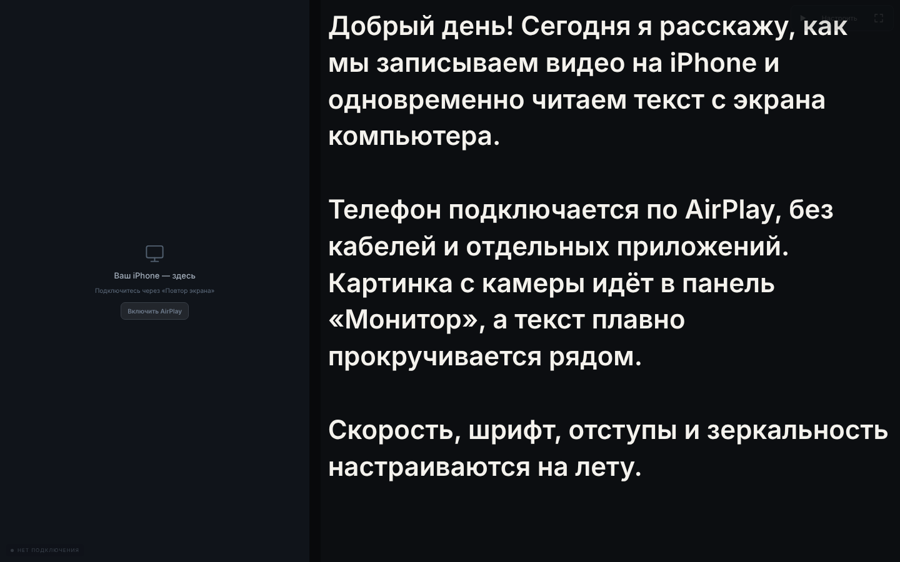

<div align="center">

# Mediaprompter

**Суфлёр и монитор камеры iPhone в одном окне. Для Windows, по AirPlay, без кабелей и облака.**

[](https://github.com/axionode/mediaprompter/actions/workflows/ci.yml)
[](https://github.com/axionode/mediaprompter/releases/latest)
[](LICENSE)


[Скачать](#установка) · [Как подключить iPhone](#подключение-iphone) · [Сборка из исходников](#сборка-из-исходников) · [English](README.en.md)



</div>

## Что это

Вы снимаете видео на iPhone и хотите читать текст, глядя почти в объектив. Mediaprompter показывает на экране компьютера сразу две вещи: картинку с телефона (через стандартный «Повтор экрана») и текст суфлёра, который плавно прокручивается с нужной скоростью. Запись идёт на сам iPhone в полном качестве, компьютер нужен только как монитор и суфлёр.

Программа работает полностью локально. Нет аккаунтов, аналитики и серверов, текст не сохраняется на диск.

## Возможности

**Суфлёр**
- Плавная прокрутка с регулируемой скоростью, пауза пробелом.
- Шрифт, размер, начертание, интервал, цвет текста и фона, выравнивание.
- Зеркальный текст для стеклянных суфлёров и линия чтения.
- Отдельное окно суфлёра поверх остальных окон, удобно вынести на второй монитор.
- Режим чтения без панелей и рамок, полноэкранный режим (F11).
- Вставка из буфера всегда без форматирования.

**Монитор iPhone**
- Приём «Повтора экрана» по AirPlay, вход по четырёхзначному коду.
- Два режима: детализация (запрос 1080p) или стабильность (запрос 720p).
- Поворот на 90/180/270°, отражение, увеличение до 400%.
- Фактическое разрешение и частота кадров видны в настройках.

**Раскладка**
- Панели свободно двигаются и меняют размер, не вылезают за рабочую область.
- Готовые раскладки: «Рядом», «Камера в углу», «Текст на весь экран».
- Точные координаты и размеры во вкладке «Макет».

<p align="center">
  
  
</p>

## Установка

Требования: Windows 10 или 11 (x64), iPhone с iOS, обе машины в одной локальной сети.

1. Откройте страницу [последнего релиза](https://github.com/axionode/mediaprompter/releases/latest) и скачайте архив `Mediaprompter-<версия>-win-x64.zip`.
2. Распакуйте его в любую папку, например `C:\Mediaprompter`. Установщик не нужен, программа портативная.
3. Запустите `Mediaprompter.exe`. Если Windows SmartScreen предупредит о неизвестном издателе, нажмите «Подробнее» → «Выполнить в любом случае» (приложение не подписано сертификатом).
4. При первом включении AirPlay Windows может спросить про доступ к сети. Разрешите доступ **к частной сети**, иначе iPhone не увидит компьютер.

Структуру папки менять нельзя: `src` и `runtime` должны лежать рядом с `Mediaprompter.exe`. Запасной способ запуска: `Start.cmd`.

## Подключение iPhone

1. Подключите iPhone и компьютер к одной Wi-Fi-сети.
2. В программе нажмите **«Подключить iPhone»**.
3. На телефоне: Пункт управления → **Повтор экрана** → **Mediaprompter**.
4. Введите код, который показан в программе.
5. Откройте «Камеру» и начните запись. Картинка появится в панели «Монитор».

Кабели и приложения на iPhone не нужны. Перед важной съёмкой проверьте, что предпросмотр не пропадает после нажатия «Запись» в выбранном режиме камеры.

### Если iPhone не видит Mediaprompter

- Проверьте, что устройства в одной сети и на компьютере не включён VPN.
- В гостевых Wi-Fi-сетях часто включена изоляция клиентов, она блокирует AirPlay.
- Проверьте, что для Mediaprompter разрешена частная сеть в брандмауэре Windows.
- Bonjour от Apple ставить не нужно, приёмник анонсирует себя сам.

## Горячие клавиши

| Клавиша | Действие |
|---|---|
| `Пробел` | Пуск / пауза |
| `↑` / `↓` | Медленнее / быстрее |
| `Page Up` / `Page Down` | Пролистать часть текста |
| `Home` | В начало |
| `Ctrl+E` | Открыть редактор |
| `Ctrl+Enter` | Применить текст в редакторе |
| `F11` | Полный экран |
| `Esc` | Выйти из режима чтения |

Когда фокус в редакторе или числовом поле, клавиши управления не перехватываются.

## Приватность

- Текст, позиция и настройки живут только в памяти сеанса. Автосохранения, истории и localStorage нет. **Скопируйте текст перед закрытием**, если он ещё нужен.
- Приёмник AirPlay запускается только по кнопке, код подключения меняется при каждом запуске.
- Внутренний поток предпросмотра доступен только на `127.0.0.1` по случайному адресу с токеном.
- Видео на компьютер не записывается. Нет телеметрии, автообновлений, служб Windows и автозагрузки.
- Окна Electron изолированы: `contextIsolation`, `sandbox`, запрет навигации, загрузок и новых окон, строгий CSP.

## Как это устроено

```
iPhone ──AirPlay (H.264)──► uxplay.exe ──GStreamer: avdec_h264 → JPEG──► 127.0.0.1 TCP
                                                                          │
                                       Electron main (src/receiver.cjs) ◄─┘
                                       MJPEG по http://127.0.0.1:<порт>/<токен>/video
                                                    │
                                       Окно суфлёра (src/index.html, renderer.js)
```

| Путь | Назначение |
|---|---|
| `src/main.cjs` | Главный процесс Electron, окна, IPC |
| `src/receiver.cjs` | Запуск AirPlay-приёмника и локальный MJPEG-поток |
| `src/renderer.js`, `index.html`, `styles.css` | Интерфейс суфлёра и монитора |
| `src/popout.*` | Отдельное окно с текстом |
| `src/core.cjs`, `video-quality.cjs` | Геометрия панелей, прокрутка, разбор JPEG |
| `native/uxplay` | Исходники встроенного приёмника [UxPlay](https://github.com/FDH2/UxPlay) |
| `patches/` | Отличия от исходного UxPlay |
| `tools/` | Сборка лаунчера, загрузка Electron, упаковка приёмника |
| `tests/` | Юнит- и интеграционные тесты |

## Сборка из исходников

Готовый архив из релизов содержит всё необходимое. Собирать самому нужно, только если вы меняете код приёмника или хотите проверить сборку.

**1. Electron**

```powershell
git clone https://github.com/axionode/mediaprompter.git
cd mediaprompter
powershell -ExecutionPolicy Bypass -File tools\fetch-electron.ps1
```

Скрипт скачивает официальный Electron 45.0.0 и сверяет SHA256.

**2. AirPlay-приёмник (UxPlay)**

Нужен [MSYS2](https://www.msys2.org/) с окружением UCRT64:

```bash
pacman -S --needed mingw-w64-ucrt-x86_64-{gcc,cmake,ninja,pkgconf,openssl,libplist} \
  mingw-w64-ucrt-x86_64-gstreamer mingw-w64-ucrt-x86_64-gst-plugins-{base,good,bad} \
  mingw-w64-ucrt-x86_64-gst-libav mingw-w64-ucrt-x86_64-python

cmake -S native/uxplay -B work/native-build -G Ninja -DCMAKE_BUILD_TYPE=Release -DNO_MARCH_NATIVE=ON
cmake --build work/native-build
python tools/package_receiver.py "$(cygpath -w /ucrt64)"
```

`package_receiver.py` копирует `uxplay.exe`, нужные плагины GStreamer и все зависимые DLL в `runtime/receiver`, а лицензии в `licenses/`.

**3. Лаунчер и запуск**

```bat
tools\build-launcher.cmd
Mediaprompter.exe
```

Без лаунчера можно запустить так: `npm start` или `runtime\electron\electron.exe .`

## Тесты

```bash
npm test                  # юнит-тесты, работают на любой ОС с Node.js 20+
npm run test:integration  # Windows + собранный runtime: приёмник, кодеки, mDNS
```

Юнит-тесты гоняются в GitHub Actions на Windows и Linux при каждом push.

## Ограничения

- Только Windows x64.
- AirPlay даёт сжатый предпросмотр с небольшой задержкой. Это монитор, а не копия исходного файла.
- Камеры по Wi-Fi (например, Panasonic Lumix) пока не поддерживаются, для них нужен отдельный протокол.
- Текст не сохраняется между запусками. Это сделано намеренно.

## Лицензия

Код Mediaprompter распространяется под [GPL-3.0-or-later](LICENSE). Встроенный приёмник основан на [UxPlay](https://github.com/FDH2/UxPlay) (GPL-3.0). Список сторонних компонентов и их лицензий: [THIRD-PARTY.md](THIRD-PARTY.md) и папка [`licenses/`](licenses).

Mediaprompter не связан с Apple. AirPlay и iPhone являются товарными знаками Apple Inc.
